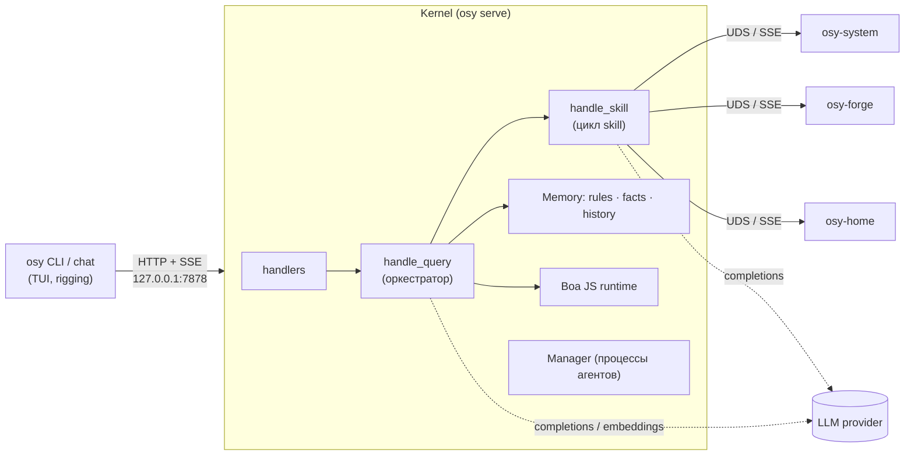

# Архитектура Osy Kernel

## Идея

Osy — **ядро-оркестратор**, а не «ещё один агентный фреймворк».
Пользователь общается с одним ИИ (оркестратором). Вся реальная работа делается
**агентами** — отдельными процессами с маленькими атомарными tools.
Оркестратор видит только короткий итоговый текст, а не сырые JSON и логи инструментов.

Проект оптимизируется под две вещи:

1. **Экономия токенов.** Тяжёлый контекст не копится: tool-трейсы не сохраняются, история заменена
   «картой диалога», знания о пользователе подтягиваются через RAG, математика уходит в JS-движок, а прямые вызовы
   (`osy skill.tool {...}`) вообще не используют LLM.
2. **Эргономика агентов.** Агент = один бинарник и один `enum` с derive-макросом `AgentSkill`.
   Транспорт, схемы tools, жизненный цикл и диалоги берёт на себя ядро.

## Топология

Звезда: все агенты общаются только с ядром, друг с другом — никогда.



- CLI ↔ ядро: **TCP на localhost** (`Client::tcp()`), ответ — SSE-поток `Event`.
- Ядро ↔ агенты: **Unix Domain Socket** `$cache/osy-{name}/socket.sock`.

## Структура репозитория

| Путь | Роль |
|---|---|
| `src/` | Бинарник ядра `osy` (CLI + сервер `serve`) |
| `crates/share` | DTO и протокол: `Event`, `Dialog`, `Skill`, `AgentMeta`, запросы, `SessionId`, `UserFact`, `UserRule`, трейт `SkillExt` |
| `crates/skill` | proc-macro `#[derive(AgentSkill)]`: генерирует `skills_list()`, `tools_list()`, `tool_call()` |
| `crates/agent` | Шаблон агента (`osy agent new`); встроен в бинарник через `include_dir!` |

Внешние крейты экосистемы (не в архиве): `rigging` (TUI/CLI), `anylm` (клиент LLM и embeddings),
`cistern` (Sled + LanceDB), `pearce` (Axum, UDS, SSE, callbacks), `atoman` (state, config, logger), `macron` (макросы).

### Модули ядра (`src/`)

| Модуль | Содержимое |
|---|---|
| `main.rs` | Таблица CLI-команд и маршрутов сервера |
| `handlers/query.rs` | **Главный цикл оркестратора** (`handle_query`) |
| `handlers/skills.rs` | **Цикл skill** (`handle_skill`) и эндпоинт прямого skill-запроса |
| `handlers/tools.rs` | Вызов одного tool агента по IPC, автовосстановление агента, проброс диалогов |
| `handlers/sessions.rs`, `users.rs` | CRUD сессий, фактов, правил |
| `skills/` | Встроенные tools: `use_skill`, `js_eval`, `remember_fact`, `search_fact`, `read_history` |
| `user/mod.rs` | `UserState`: Sled (метаданные, правила) и LanceDB (факты), сохранение и поиск фактов |
| `user/session.rs` | `Session`: история пар, локальные правила, карта диалога (с кэшем), клонирование |
| `manager/` | Запуск, проверка и перезапуск агентов, генерация списка skills и tools |
| `runtime/` | Песочница Boa JS с лимитом итераций |
| `utils/` | Embeddings, подготовка запроса к фактам, backoff, TUI-виджеты, рендер событий |
| `commands/` | Реализация CLI-команд (`chat`, `do`, `server`, `agent`, `trace`, `status`) |

## Хранилище

```
$share$/users/{uid}/
├── userdata/            Sled: user_metadata, rules (глобальные)
├── context/             LanceDB: таблица facts (вектор + UserFact)
└── sessions/{sid}/      Sled: metadata, message(0..N) пары User→Assistant, rules (локальные)
```

- `uid = 0` — **эфемерный** пользователь: сессия стирается с диска при `finish`.
- В истории хранятся только пары *(исходное сообщение пользователя, финальный ответ)*. Tool-вызовы и промежуточные сообщения не записываются.
- `UserState` и `Session` живут в памяти, пока есть активные сессии (`evict_if_idle`).

## HTTP API ядра

| Группа | Маршруты |
|---|---|
| Health | `GET /ping`, `/status`, `/refresh`, `/options` |
| Users | `POST /users/{uid}/sessions`; `facts/{list,set,remove,clear,search}`; `rules/{list,set,remove,clear}` |
| Sessions | `POST /sessions/{sid}/{metadata,init,finish,rename,clear,remove,clone}`; `rules/{list,set,remove,clear}` |
| Запросы | `POST /sessions/{sid}/query` (оркестратор), `/sessions/{sid}/skills/{skill}/query` (один skill), `/skills/{skill}/call/{tool}` (прямой tool) |
| Callback | `/callback/{id}` — ответы на `Dialog` |

## Протокол событий

Поток от ядра к клиенту — SSE с JSON `Event`:

| Event | Назначение |
|---|---|
| `Thinking(String)` | Статус выполнения |
| `Answer(String)` | Токены ответа |
| `Error(String)` | Ошибка (не обязательно фатальная) |
| `Dialog(Dialog)` | Интерактивный запрос к пользователю |
| `Finish` | Конец потока |

`Dialog`: `Script`, `Confirm`, `Prompt` (в т.ч. multiline), `Secret`, `Select`.
Каждый диалог содержит `id`. Ядро (или агент) регистрирует `Callback::register(id)` и ждёт, пока клиент отправит
результат на `/callback/{id}`. Диалоги агента ядро ретранслирует клиенту и возвращает ответ агенту по IPC.
`Dialog::Script` исполняется **на стороне CLI** (bash или cmd, опционально с sudo) и возвращает `CommandResult`.

> ⚠️ CLI выполняет `Script` сразу, без собственного подтверждения. Если нужно согласие пользователя, агент обязан
> сам прислать `Dialog::Confirm` перед `Script`. README говорит об «approvals», но гарантии на уровне ядра нет.

## Контракт агента

```
osy-<name> metadata    → JSON AgentMeta (name, description, version, skills{name→Skill}, sock_path)
osy-<name> serve       → HTTP на UDS:
    GET  /ping, /refresh
    POST /skills/list
    POST /skills/{skill}/tools            → Vec<Tool> (JSON-схемы)
    POST /skills/{skill}/call/{tool}      → SSE Event (Answer / Dialog / Error / Finish)
```

Определение skill (весь код агента-шаблона):

```rust
#[derive(AgentSkill, ...)]
pub enum SkillKind {
    /// Test skill.
    #[tool(name = "hello", description = "Prints hello.")]
    Test,
}
```

Макрос генерирует системный промпт skill («Your domain responsibility: …»),
схемы tools из `#[derive(Schema)]` структур и диспетчер `tool_call` по имени. Нужно написать `handle_hello(tx, query)` в модуле `test`.

### Жизненный цикл агента (`manager/`)

1. `Manager::init` сканирует каталог ядра (`$/`) на бинарники `osy-*`.
2. Для каждого: `osy-x metadata` → `AgentMeta`; запуск `osy-x serve`; ожидание `/ping` по UDS (50 попыток по 100 мс).
3. Агент привязан к ядру: на Linux `PR_SET_PDEATHSIG=SIGKILL`, на macOS — выход при закрытии stdin.
4. `Manager::gen_doc` собирает список skills для системного промпта оркестратора.
5. `osy refresh` → `Manager::update`: мёртвые агенты и агенты с более новым бинарником (mtime) перезапускаются, остальным шлётся `/refresh` (перечитать конфиг).

## Что видит каждый участник

| | Оркестратор | Skill (LLM-цикл агента) |
|---|---|---|
| История чата | последняя пара + карта диалога | нет |
| Rules, facts (авто-RAG) | да | нет |
| Список skills | да | нет |
| Tools | `use_skill`, `js_eval`, `remember_fact`, `search_fact`, `read_history` | `js_eval`, `remember_fact`, `search_fact` + tools агента |
| Вход | сообщение пользователя | только `query`, переданный оркестратором |

Агенты «не имеют доступа к пользовательскому контексту». Точнее: они не видят **историю диалога**,
но через `search_fact` и `remember_fact` имеют доступ к долговременным фактам пользователя (RAG).

## Конфигурация (`$config$/config.toml`)

| Секция | Ключи (по умолчанию) |
|---|---|
| `server` | `port = 7878` |
| `execution` | `max_retries = 3` (подряд), `max_total_errors = 6`, `max_iterations = 5` (оркестратор), `skill_max_iterations = 8`, `max_identical_calls = 3`, `preserve_messages = 2` (**зарезервировано**) |
| `runtime` | `instruction_limit = 5_000_000` (на деле лимит итераций циклов Boa) |
| `llm` | промпты (`system`, `assist`, `skill`, `control`, `compress` — **не используется**), температуры, провайдеры `completions` и `embeddings` |
| `context` | `fact_similarity = 0.3` (косинус), `fact_margin = 0.12`, `hybrid_search = true`, `dedup_similarity = 0.92`, `search_limit = 8`, `facts_max_chars = 800`, `dialog_map_turns = 30`, `dialog_map_chars = 160` |

Модели по умолчанию: `qwen/qwen3-coder-next` (completions) и `perplexity/pplx-embed-v1-0.6b` (embeddings) через OpenAI-совместимый `routerai.ru`.

> Конфиг читается с диска, и промпты по умолчанию записываются в `config.toml` при первом запуске. Изменённые в коде промпты
> (`assist`, `skill`, `control`) применятся только после удаления старых значений из вашего `config.toml` (или всего файла).
> Новые числовые параметры подхватываются сами (`#[serde(default)]`), устаревшие ключи `translate_*` и `normalize_*` игнорируются.
