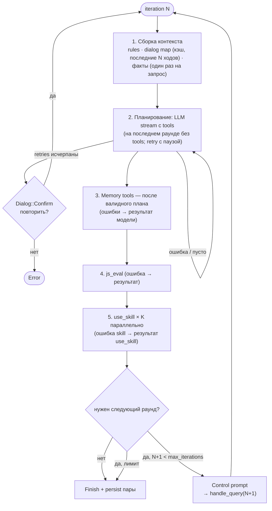
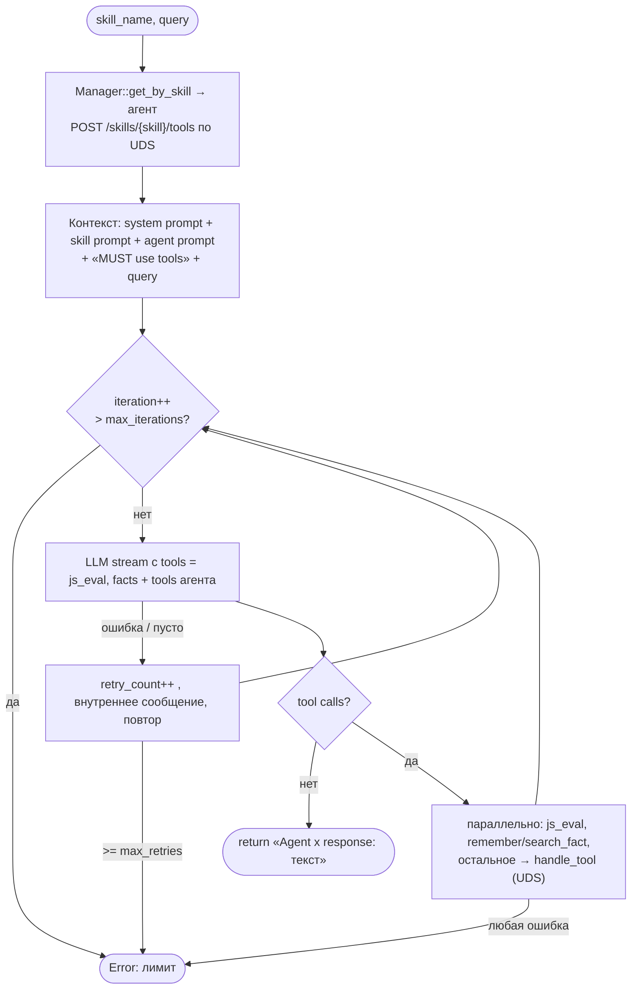

# Алгоритмы обработки запросов

Три входа, три разных «цены» по токенам.

| Вход | Команда | Путь | LLM-вызовов |
|---|---|---|---|
| Прямой tool | `osy skill.tool {json}` или `key=value` | CLI → `/skills/{skill}/call/{tool}` → агент | **0** |
| Один skill | `osy do skill "текст"`, `osy chat -s skill` | `/sessions/{sid}/skills/{skill}/query` → `handle_skill` | ≥ 2 (tool-вызов + финальный текст) |
| Оркестратор | `osy chat` | `/sessions/{sid}/query` → `handle_query` | ≥ 1, при действиях ≥ 4 |

## 1. Оркестратор (`handlers/query.rs`)

### Подготовка (один раз на запрос)

`handle_user_query` загружает **только последнюю пару** `(User, Assistant)` из сессии и запускает рекурсивный
`handle_query(iteration = 0)`.

### Итерация `handle_query`



**Порядок сообщений, которые уходят в LLM** (от стабильного к изменчивому — удобно для prompt caching провайдера)

```
[system, Internal]  assist prompt + список skills + RULES + Dialog map (последние N ходов)
[history]           последняя пара User → Assistant (+ шаги текущего хода при рекурсии)
[system, Internal]  base prompt (ОС, путь, время до минуты) + USER FACTS
[user]              текущее сообщение (или control prompt на итерациях > 0)
```

System-блоки **пересобираются на каждой итерации**, а в переносимой истории (`raw_messages`) их нет
(фильтр `Role::System`): раньше они накапливались при рекурсии.

**Шаг за шагом**

1. **Контекст.** Rules, карта диалога (кэш в `Session`, последние `dialog_map_turns` ходов), факты.
   Факты ищутся **один раз на запрос** по тексту сообщения пользователя (без перевода; пустые реплики вроде «ок» пропускаются)
   и переиспользуются control-раундами. Блок ограничен `search_limit` и `facts_max_chars`.
2. **Планирование.** Стрим с tools (`use_skill`, `js_eval`, `remember_fact`, `search_fact`, `read_history`):
   - `Chunk::Text` → сразу `Event::Answer` и накопление;
   - tool calls только **собираются**; на последнем раунде tools не передаются, а случайные вызовы игнорируются;
   - ошибки запроса и потока, а также пустой ответ → внутреннее сообщение, пауза, повтор (счётчики `max_retries`, `max_total_errors`).
3. **Memory tools** выполняются после того, как план получен целиком. Их ошибки и неизвестные tools возвращаются модели текстом.
4. **JS.** Ошибка исполнения = результат `JS Error: …`.
5. **Skills** параллельно. Упавший skill пишет ошибку в результат `use_skill`, остальные задачи не затрагиваются.
6. **Следующий раунд** нужен, если были skills, JS, несилентные результаты memory (например, «похожий факт уже есть») или модель
   ничего не написала. Сохранённый факт при уже готовом ответе — «тихая» операция: запрос завершается без лишнего LLM-вызова.
   Перед последним раундом к control prompt добавляется предупреждение, что tools больше нет.
7. **Завершение.** `Finish` и `persist_turn_pair(root_user_msg, final_text)`: в историю идёт только исходный вопрос и итоговый текст.

### Что учесть при чтении кода

- Клиент отключился (`tx.is_closed()`) → все воркеры прерываются (`abort_all`).
- `ask_retry` теперь только для случая «не удалось получить план»; на этом этапе побочных эффектов ещё нет.
- Расчёт вызовов см. в таблице ниже.

## 2. Skill (`handlers/skills.rs::handle_skill`)

Изолированный LLM-цикл одного skill. Вызывается из оркестратора (`stream_answer = false`) или напрямую
(`stream_answer = true`, ответ стримится пользователю).



Особенности:

- Skill не видит историю чата, только `query`, который сформулировал оркестратор.
- Tools агента запрашиваются по IPC при каждом вызове skill (кэша нет).
- Ошибки tools (в том числе невалидные аргументы и ошибки агента) возвращаются модели как результат; модель исправляет вызов.
- Повторные ошибки LLM: пауза и повтор; счётчик подряд идущих сбрасывается после удачного шага.
- Лимит шагов `skill_max_iterations` (8): последний шаг выполняется без tools, модель сообщает результат и что не удалось.
- Одинаковый вызов (tool + аргументы) выполняется не более `max_identical_calls` (3) раз за запуск.
- Первый ответ без tool calls считается результатом, даже если модель ответила «из головы» (проверка только в промпте).
- Прямой запуск (`osy do skill …`) сохраняет в сессию пару *(запрос, ответ skill)*.

## 3. Вызов tool (`handlers/tools.rs::handle_tool`)

1. `POST /skills/{skill}/call/{tool}` по UDS, ответ — поток `Event`.
2. Если агент недоступен → `agent.ensure()` → **один** повтор запроса.
3. Чтение потока:
   - `Answer` накапливается в результат;
   - `Dialog` ретранслируется клиенту, ядро ждёт ответ (callback, 120 с) и пересылает его агенту;
   - `Error` агента при вызове **от модели** попадает в результат (`Tool error: …`), пользователю уходит статус `Thinking`;
     при прямом вызове из CLI ошибка пересылается как есть;
   - `Thinking` пробрасывается клиенту.
4. Невалидный JSON аргументов от модели возвращается ей как результат, а не обрывает skill.
5. Пустой результат заменяется на `Tool finished without output.`

## 4. Прямой вызов tool (0 токенов)

`osy test.hello name=Bob` → `skill.tool` определяется по точке → аргументы парсятся (`{json}` или `key=value`) →
SSE-поток от агента рендерится как есть. LLM не участвует, ядро только маршрутизирует.

## Цена типовых сценариев

| Сценарий | LLM / embeddings |
|---|---|
| Простой вопрос | 1 completion + 1 embedding (если факты ищутся) |
| «Запомни: …» с ответом | **1 completion** + 1 embedding (раньше 3 completion) |
| «Запомни» без текста ответа | 2 completion (control-раунд) |
| Одно действие через skill | планирование (1) + skill (≥2) + control (1) = ≥ 4 completion |
| N параллельных skills | то же + N·(≥2) |
| `osy skill.tool` | 0 |

Перевод запросов и «нормализация» фактов больше не используют LLM. Карта диалога не читает БД на каждой итерации (кэш).
