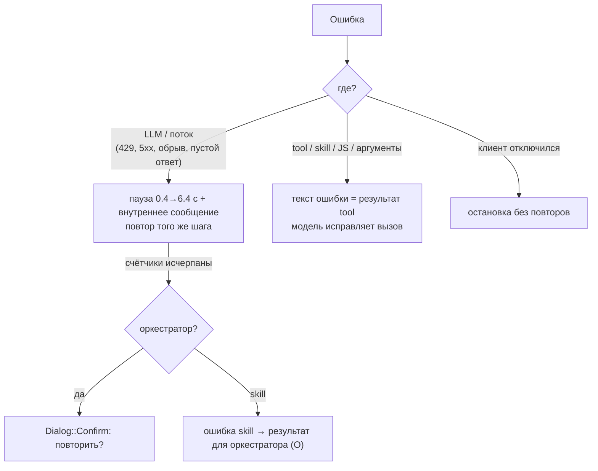

# Self-healing loop

Цель: сбой не убивает сессию, а ошибка модели исправляется на месте, без участия человека и без повтора уже выполненной работы.

> Описано состояние **после** исправлений. Код не компилировался (в архиве нет внешних крейтов), см. раздел «Проверить» в конце.

## Принцип

**Ошибка исполнения — это наблюдение для модели, а не исключение.** Любой сбой tool, skill или JS превращается в текст результата
(`Tool error: …`), модель видит его и исправляет вызов в следующем шаге. Человек спрашивается только тогда, когда не удаётся
получить сам план (LLM недоступна).

## Уровни

| Уровень | Где | Что ловит | Реакция |
|---|---|---|---|
| **L0. Процесс агента** | `handlers/tools.rs`, `manager/agent.rs` | IPC-запрос не прошёл | `agent.ensure()` (перезапуск) и **один** повтор запроса; если не вышло, ошибка уходит на L1 как результат tool |
| **L1. Tool** | `handlers/skills.rs::run_sub_tool`, `handlers/tools.rs` | Ошибка tool, невалидный JSON аргументов, `Event::Error` агента, `js_eval` | Текст ошибки возвращается модели как результат; пользователь видит строку статуса |
| **L2. LLM в skill** | `handlers/skills.rs` | Ошибка запроса, обрыв потока, пустой ответ | Внутреннее сообщение + пауза + повтор. Счётчики: `max_retries` подряд, `max_total_errors` за запуск |
| **L3. Skill целиком** | `skills/skill.rs` | Skill упал (исчерпаны L2 и т. п.) | Ошибка становится результатом `use_skill`; оркестратор решает: повторить с другими параметрами или сообщить |
| **L4. LLM в оркестраторе** | `handlers/query.rs` | Те же ошибки при планировании, невалидные аргументы tools | Внутреннее сообщение + пауза + повтор; затем `Dialog::Confirm` (300 с). «Да» повторяет итерацию: на этом этапе ничего ещё не выполнялось |
| **L5. Control-раунд** | `control_prompt` | Результаты с ошибками | Модель повторяет вызов один раз с исправленными параметрами или честно сообщает о сбое |

Дополнительно: `tx.is_closed()` проверяется везде (отключение клиента останавливает цепочку), агенты умирают вместе с ядром.

## Что исправлено

| Было | Стало |
|---|---|
| Ошибка `js_eval` завершала весь запрос | Текст `JS Error: …` возвращается модели |
| Ошибки tool и невалидный JSON аргументов роняли skill | Возвращаются как результат tool (`Tool error: …`) |
| `Event::Error` агента не попадал в результат (модель видела пустоту) | Накапливается и добавляется к результату; пользователю уходит статус `Thinking` |
| Пустой результат tool | Заменяется на `Tool finished without output.` |
| Упавший skill → вопрос пользователю → повтор **всей** итерации, включая успешные задачи | Ошибка skill — результат `use_skill`; успешные задачи не перезапускаются |
| Memory-tools выполнялись прямо в стриме; при ошибке потока перезапись и повторное выполнение | Выполняются после того, как план целиком получен; их ошибки становятся результатами |
| Неизвестный tool молча игнорировался (висящий tool call без результата) | Модель получает `Unknown tool … Available tools: …` |
| `retry_count` в skill не сбрасывался; retry съедал итерации | Счётчик подряд идущих ошибок сбрасывается после успешного шага; итерации считаются только по удачным шагам; `max_total_errors` ограничивает суммарные сбои |
| Мгновенные повторы | Пауза 0.4 с, 0.8 с, 1.6 с… (`utils::backoff`) для сбоев запроса и потока |
| Один `max_iterations` на всё | `max_iterations` (оркестратор) и `skill_max_iterations` (skill, по умолчанию 8) |
| Лимит итераций — жёсткая ошибка, работа теряется | Последний шаг выполняется **без tools** и с подсказкой «сообщи результат и что не удалось» |
| Бесконечные одинаковые вызовы | После `max_identical_calls` (3) одинаковых вызовов в skill tool не выполняется, модель получает подсказку изменить подход |

## Что осталось

- **Классификация ошибок.** Нет разделения «повторяемая / фатальная» (401, переполнение контекста): нужен тип ошибки из `anylm`.
- **Skill без tools.** Запрет «отвечать из головы» держится только на промпте.
- **Fallback-модель** после исчерпания исправлений.
- **Ошибка `ensure()`** (L0) по-прежнему теряется: в сообщении только «failed to recover».
- Одинаковые вызовы в **оркестраторе** не ограничиваются отдельно (достаточно лимита итераций).

## Проверить после сборки

1. `m.role != Role::System` в `handlers/query.rs`: имя варианта (`Role::System`) предполагается по `Message::system`.
2. `Completions::tools(..)` принимает и возвращает `Self` (builder по значению): так сделаны остальные builder-ы проекта.
3. Что `anylm` дописывает ответ ассистента в общий `Messages` (на этом построена связка tool call → `push_content`).
4. Поведение `table.read(.., threshold)` в `cistern` (см. [rag-facts.md](rag-facts.md)).
